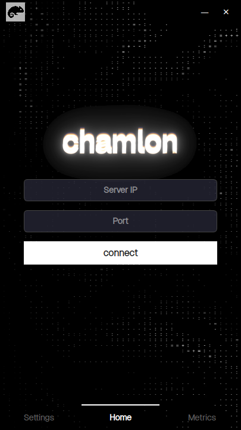
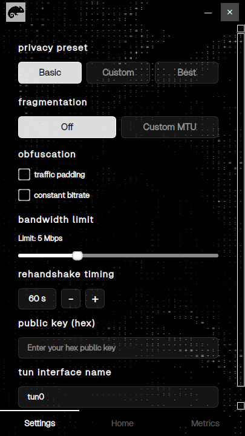
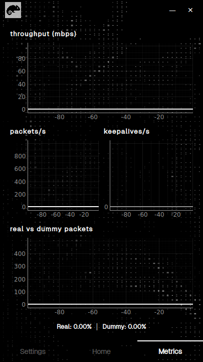

# Chamlon VPN

A lightweight, encrypted VPN built from scratch in C and Python. Chamlon tunnels IP traffic over UDP using modern authenticated encryption (ChaCha20-Poly1305), with a graphical client interface built in PyQt5.

---

## The Client

The graphical client is a single 405x720 window: a connection page, a settings
page for everything the command-line client takes as arguments, and a live
metrics page.

| Home | Settings | Metrics |
|---|---|---|
|  |  |  |

Enter the server's address and port on the home page, paste the server's public
key into the settings page, and press connect.

---

## Installation

One command, on any Ubuntu or Debian release:

```bash
git clone <repo-url> && cd Chamlon
./setup.sh
```

It asks for your password once, then installs the compiler and libsodium,
installs the GUI's Python dependencies, and builds both binaries. It is safe to
re-run at any time: every step checks what is already present before touching
anything.

Written for Ubuntu 20.04 through 25.04 and Debian 11 and 12 (the package
names that were renamed between those releases are all handled); verified
end to end on Ubuntu 24.04.

```bash
./setup.sh --build-only   # just rebuild the binaries, install nothing
./setup.sh --no-gui       # server and command-line client only
```

The installer deliberately takes PyQt5, OpenCV and pyqtgraph from the
distribution's own packages rather than from pip. Two copies of Qt in one
process is what produces the familiar `could not load the Qt platform plugin
"xcb"` crash, and a pip install is what puts the second copy there. pip is used
only as a fallback, for a module the distribution does not ship.

### If something goes wrong

| What you see | What it means |
|---|---|
| `another package manager is running` | Ubuntu's unattended-upgrades holds the dpkg lock. The installer waits for it; nothing to do. |
| `could not install: ...` | Run `sudo apt-get update` and look at what it reports: usually a third-party repository that no longer resolves. |
| `/dev/net/tun is missing` | `sudo modprobe tun`. In a container, the TUN device has to be passed in. |
| `no graphical session` from `./chamlon` | You are on a text console or an SSH session without X forwarding. Use `ssh -X`, or the command-line client. |

---

## Project Structure

```
chamlon/
├── chamlon_server/       # VPN server (C)
├── chamlon_client/       # VPN client (C)
├── chamlon_utilities/    # Shared utilities
├── chamlon.py            # Graphical client (PyQt5)
├── chamlon               # Launcher for the GUI: handles root and the display
└── setup.sh              # One-shot installer and builder
```

---

## How It Works

### Overview

Chamlon creates an encrypted tunnel between a client and a server. All traffic is sent over UDP and encrypted end-to-end. The server assigns each connected client a private IP address in the `10.10.0.0/24` subnet and forwards their traffic to the internet using NAT.

```
[Client App]
     │  (plain IP traffic)
     ▼
[TUN interface]
     │  encrypt + fragment
     ▼
[UDP socket] ──────────────────► [UDP socket]
                                       │  decrypt + reassemble
                                       ▼
                                 [TUN interface]
                                       │  (plain IP traffic → Internet)
                                       ▼
                                  [NAT / Internet]
```

### Handshake

Before any data is exchanged, client and server perform a cryptographic handshake to establish a shared session key:

1. **Client → Server (MSG1):** The client sends its ephemeral X25519 public key and a random nonce.
2. **Server → Client (MSG2):** The server replies with its own ephemeral public key, nonce, the assigned VPN IP, and a signature over both sides' keys and nonces using its long-term Ed25519 identity key. The client verifies this signature to authenticate the server.
3. **Both sides** independently derive two symmetric session keys (send and receive) from the Diffie-Hellman shared secret using BLAKE2b, and a unique `session_id` used to identify all future packets.

This design provides:
- **Server authentication** via the Ed25519 signature
- **Forward secrecy** via ephemeral X25519 keys (past sessions cannot be decrypted if the server's long-term key is later compromised)

### Data Transfer

Once the session is established:

- Each packet is **fragmented** if it exceeds the configured MTU.
- Each fragment is **encrypted** with ChaCha20-Poly1305 (AEAD), with the `session_id` and sequence number as authenticated data. This prevents tampering and replay attacks.
- The server maintains a **sliding window** per session to detect and discard duplicate or replayed packets.

### Session Management

- The server supports up to **250 simultaneous clients**.
- Each client is assigned a VPN IP from `10.10.0.2` to `10.10.0.251`.
- Sessions inactive for more than **60 seconds** are cleaned up automatically.
- The server sends **keepalive packets** every 10 seconds to maintain sessions through NAT.

### Rate Limiting & Security

- Handshake attempts per IP are rate-limited to prevent abuse.
- Data packet rates are also limited per session.
- IPs that exceed limits are temporarily blacklisted.
- Cryptographic material (session keys, session IDs) is zeroed from memory when a session ends.

---

## Requirements

- Linux: Chamlon uses TUN devices and iptables, so Windows needs WSL2 and
  macOS a virtual machine
- root, for the TUN interface and the NAT rules
- `build-essential` and `libsodium-dev` to build
- `python3`, `python3-pyqt5`, `python3-pyqt5.qtmultimedia`, `python3-opencv`,
  `python3-pyqtgraph`, `python3-requests` for the GUI

`./setup.sh` installs all of it; the list is here for anyone packaging Chamlon
by hand.

---

## Running the Server

The server requires root to manage the TUN interface and iptables NAT rules.

```bash
cd chamlon_server
sudo ./vpn_server <bind-ip> <port>

# Example: listen on all interfaces, port 55555
sudo ./vpn_server 0.0.0.0 55555
```

On startup, the server will print its **Ed25519 public key**. Copy this since clients need it to verify the server's identity.

---

## Running the Client

### Graphical interface

```bash
./chamlon
```

Enter the server's IP, port and public key in the GUI to connect.

The client opens a TUN device and rewrites the routing table, so it runs as
root. The `./chamlon` wrapper is what arranges that: `sudo` strips `DISPLAY`
and `XAUTHORITY`, X11 refuses a connection from another user until it is
allowed in, and under Wayland a root process has no Wayland socket at all and
has to go through XWayland. The wrapper sets all three up and puts them back
afterwards. Running `sudo python3 chamlon.py` by hand works on some desktops
and fails on others for exactly these reasons.

### Command-line client

```bash
cd chamlon_client
sudo ./vpn_client <server-ip> <port> <server-public-key> [options]

# Example: listen on all interfaces, port 55555
sudo ./vpn_client <server-ip> <port> <server-public-key> MBPS:5 FRAG:Y:900 CBR:N PAD:Y REHANDSHAKE:120 TUN:interface_client

```

Once connected, the client is assigned a VPN IP (e.g. `10.10.0.2`) and all traffic is tunnelled through the server.

---

## Configuration

Core parameters are defined at compile time in `chamlon_server/include/config.h`:

| Parameter | Default | Description |
|---|---|---|
| `MAX_CLIENTS` | 250 | Maximum simultaneous clients |
| `SESSION_TIMEOUT_SEC` | 60 | Seconds before idle session is dropped |
| `KEEPALIVE_INTERVAL_SEC` | 10 | Keepalive interval |
| `MAX_FRAG` | 1600 | Maximum encrypted fragment size (bytes) |
| `WINDOW_SIZE` | 64 | Replay detection window |

---

## Security Notes

- The server's long-term identity key is stored in `server_static.key` (auto-generated on first run). **Keep this file private.**
- Chamlon uses only [libsodium](https://libsodium.org) for all cryptographic operations.

---

## Dependencies

| Component | Technology |
|---|---|
| Server & Client | C (C17), libsodium |
| GUI | Python 3, PyQt5 |
| Encryption | ChaCha20-Poly1305 (AEAD) |
| Key exchange | X25519 (Diffie-Hellman) |
| Server auth | Ed25519 signatures |
| Key derivation | BLAKE2b |
| Network | UDP + Linux TUN + iptables NAT |
